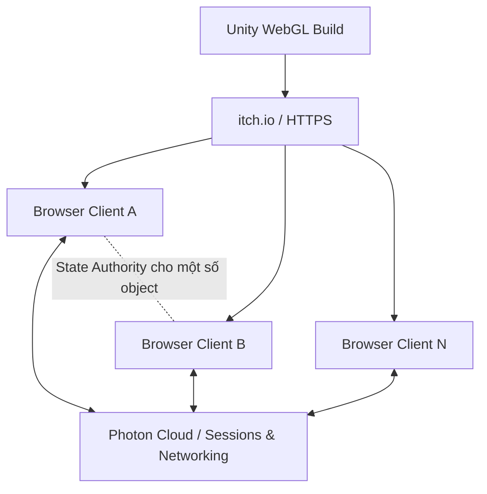
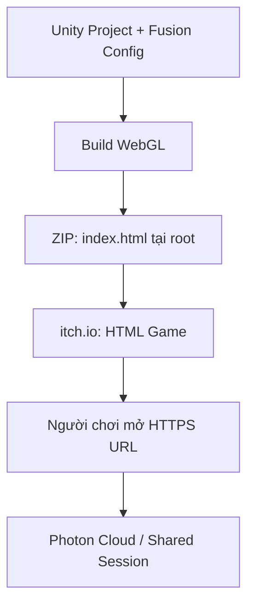

# Network Architecture v1.0

> **Project:** Unity WebGL Multiplayer  
> **Distribution:** itch.io (HTML5)  
> **Networking:** Photon Fusion 2 — Shared Mode  
> **Status:** Network architecture baseline; gameplay chưa được định nghĩa.

## 1. Mục tiêu và phạm vi

Game chạy trực tiếp trong trình duyệt máy tính, được phân phối qua itch.io. Người chơi có thể tạo phòng riêng, chia sẻ mã phòng và tham gia qua Internet mà không cần LAN, mở port router hay thuê dedicated game server.

**Mục tiêu thiết kế:** 10–20 người/phòng (cần kiểm chứng bằng benchmark), ưu tiên sử dụng hạn mức miễn phí của Photon.

Tài liệu **chỉ** mô tả kết nối, phiên chơi, authority, đồng bộ state, vòng đời đối tượng, xử lý lỗi, deployment và kiểm thử. **Không chốt gameplay** (di chuyển, va chạm, tương tác, nhân vật, luật chơi hoặc vật thể cụ thể).

## 2. Các quyết định kiến trúc

| Hạng mục | Quyết định |
|---|---|
| Engine | Unity (phiên bản phải tương thích với Fusion 2 và WebGL) |
| Platform | WebGL, trình duyệt PC |
| Hosting file | itch.io qua HTTPS |
| Networking SDK | Photon Fusion 2 |
| Topology | Shared Mode |
| Network service | Photon Cloud |
| Quản lý phòng | Fusion Sessions |
| Kết nối bạn bè | Private Session + Room Code |
| Đồng bộ state | `[Networked]` properties, RPC khi phù hợp |
| Authority | Distributed State Authority, từng `NetworkObject` |
| Game server riêng | Không sử dụng |
| Chi phí | Ưu tiên free tier; giới hạn theo chính sách Photon |
| Target capacity | 10–20 người/phòng; không cam kết trước khi đo |

### Sơ đồ tổng thể



**Lưu ý:** itch.io chỉ phân phối game. Photon Cloud cung cấp dịch vụ session và truyền dữ liệu, **không** thay client chạy một game simulation authoritative chung. Mỗi network object được một peer nắm State Authority tại một thời điểm.

## 3. Phân lớp hệ thống

```text
Application / Gameplay (chưa định nghĩa)
           |
Network Abstraction / Interfaces
           |
Session & Connection Services
           |
Authority & Synchronization Services
           |
Photon Fusion 2 (NetworkRunner, NetworkObject, NetworkBehaviour)
           |
Photon Cloud / WebGL-compatible Transport
           |
Browser Runtime (Unity WebGL trên itch.io)
```

- Gameplay gọi API từ tầng abstraction thay vì thao tác trực tiếp lên dịch vụ lobby hay room code.
- Wrapper không nhất thiết phải che giấu **mọi** API Fusion: chỉ trừu tượng hóa các ranh giới có khả năng thay đổi.
- Tránh xây framework generic quá mức trước khi có nhu cầu thực tế.

## 4. Session & Room Management

### 4.1. Session Metadata

| Thuộc tính | Ý nghĩa |
|---|---|
| `SessionId` | Tên/định danh phiên trên Photon |
| `RoomCode` | Mã ngắn được tạo và ánh xạ duy nhất đến session hoặc dùng làm tên session |
| `MaxPlayers` | Sức chứa cấu hình; mục tiêu tối đa 20 |
| `Visibility` | Private mặc định |
| `GameVersion` | Phiên bản build tương thích |
| `Status` | Creating, Active, Closing, Closed |

Mã phòng không phải IP của người chơi. Cần tránh trùng mã, xử lý phòng hết hạn/đầy và xác minh session khi tham gia. Mã phòng dễ đoán **không được xem là bảo mật mạnh**.

### 4.2. Create Room

1. Khởi tạo Fusion và kết nối Photon Cloud.
2. Sinh Room Code/Session Name hợp lệ.
3. Tạo Shared Session với sức chứa và metadata.
4. Xác nhận tạo thành công rồi hiển thị mã phòng.
5. Chuyển sang trạng thái `Connected`.

### 4.3. Join Room

1. Nhận Room Code.
2. Tìm hoặc truy cập session tương ứng.
3. Kiểm tra phiên bản và khả năng tham gia.
4. Join Shared Session.
5. Đồng bộ trạng thái network object hiện có.
6. Chuyển sang trạng thái `Connected`.

### 4.4. Connection State Machine

```text
Disconnected -> Connecting -> Joining -> Connected
                    |            |          |
                    +------------+----------+-> Failed
Connected -> Reconnecting -> Connected | Disconnected
Connected -> Disconnecting -> Disconnected
```

Cần xử lý: không tìm thấy phòng, phòng đầy, sai phiên bản, timeout, mất mạng, refresh tab, bị ngắt kết nối và session không còn tồn tại.

> Shared Mode không có một Player Host authoritative cho toàn phòng. Người tạo session rời đi **không nhất thiết** làm phòng kết thúc; việc duy trì và chuyển giao authority cần có chính sách rõ ràng.

## 5. Authority Architecture

- Mỗi `NetworkObject` có **một State Authority** tại một thời điểm.
- Chỉ peer có quyền mới được ghi authoritative replicated state của object.
- Các peer khác nhận state và render/đồng bộ theo khả năng của Fusion.
- Không đồng nhất `room creator`, `input owner` và `state authority` thành cùng một vai trò.

### 5.1. Nhóm authority tổng quát

| Nhóm object | Chính sách dự kiến |
|---|---|
| Player-owned network object | Ưu tiên peer sở hữu làm State Authority |
| Shared world object | Chỉ một peer được cấp authority |
| Session-level network state | Một peer điều phối theo quy tắc được xác định |
| Temporary network object | Gán authority khi spawn |
| Local-only object | Không cần `NetworkObject` |

Đây là nhóm **mạng**, không quy định loại gameplay object cụ thể.

### 5.2. Authority Lifecycle

`Acquire -> Validate -> Replicate -> Release / Reassign`

Khi peer mất kết nối:

1. Xác định các network object đang phụ thuộc vào peer đó.
2. Áp dụng chính sách chuyển quyền hoặc cleanup tương ứng.
3. Khôi phục trạng thái được replicate có thể tiếp tục sử dụng.
4. Thông báo thay đổi đến module liên quan.

**Không giả định** Fusion tự động bảo toàn mọi trạng thái tạm và tự chuyển quyền cho mọi object. Phải kiểm chứng hành vi thực tế của từng chế độ và cấu hình object.

## 6. Đồng bộ dữ liệu

| Loại | Cơ chế | Quy tắc |
|---|---|---|
| Persistent replicated state | `[Networked]` properties | Là nguồn trạng thái hiện tại cho cả late joiner |
| Transient notifications | RPC | Dùng cho sự kiện; không thay thế state lâu dài |
| Local-only state | C# state thông thường | Không network nếu không cần |

Quy tắc nền:

- Chỉ gửi dữ liệu thực sự cần qua mạng.
- Tránh broadcast các thay đổi không cần thiết.
- Late joiner phải tái tạo được trạng thái hiện tại mà không phụ thuộc vào RPC quá khứ.
- Sử dụng interpolation khi cần hiển thị dữ liệu liên tục.
- Prediction/reconciliation chỉ bổ sung khi gameplay cụ thể cần; **chưa chốt ở phiên bản này**.
- Tick rate, replication frequency, interest management và data budget sẽ được quyết định sau profiling.

## 7. Network Object Lifecycle

`Spawn -> Initialize -> Replicate -> Despawn`

- Prefab mạng được đăng ký/đồng bộ nhất quán giữa các build tương thích.
- Chỉ peer có quyền phù hợp mới spawn/despawn hoặc sửa authoritative state.
- Networked objects phải có cleanup rõ ràng khi leave session hoặc tải lại scene.
- Local-only objects không tự động trở thành network objects.
- Object ownership/authority loss được xử lý theo chính sách chung ở Mục 5.

## 8. Cấu trúc module đề xuất

```text
Networking/
├── Core/
│   ├── NetworkBootstrap
│   └── NetworkConfig
├── Session/
│   ├── SessionService
│   └── RoomCodeService
├── Connection/
│   └── ConnectionService
├── Authority/
│   └── AuthorityService
├── Synchronization/
│   └── ReplicationUtilities
├── Objects/
│   └── NetworkObjectService
├── Interfaces/
│   ├── INetworkService
│   ├── ISessionService
│   ├── IConnectionService
│   ├── IAuthorityService
│   ├── INetworkObjectService
│   └── INetworkDiagnostics
└── Diagnostics/
    └── NetworkDiagnostics
```

Tên file/class chỉ là cấu trúc dự kiến, không bắt buộc tạo tất cả trước khi triển khai.

| Interface | Trách nhiệm |
|---|---|
| `INetworkService` | Khởi tạo và shutdown networking |
| `ISessionService` | Create, join, leave, quản lý session metadata |
| `IConnectionService` | Theo dõi kết nối, lỗi và reconnect |
| `IAuthorityService` | Kiểm tra/yêu cầu authority |
| `INetworkObjectService` | Spawn, despawn, vòng đời đối tượng |
| `INetworkDiagnostics` | Logs, RTT, mức sử dụng mạng nếu API hỗ trợ |

Đây là interface do dự án thiết kế, không phải interface có sẵn của Fusion.

## 9. WebGL Runtime Constraints

- Trình duyệt không cho Unity sử dụng native UDP socket trực tiếp như build desktop.
- Chỉ dùng phương thức kết nối được Photon Fusion hỗ trợ trên WebGL.
- Không thiết kế phụ thuộc vào một background server chạy liên tục trong browser.
- Tab nền có thể bị throttling hoặc tạm dừng.
- Refresh/đóng tab phải được xem như disconnect không báo trước.
- Client không đáng tin cậy: không đặt server secrets vào WebGL build.
- Kiểm tra khả năng tương thích Unity/Fusion/WebGL ở phiên bản SDK cụ thể trước triển khai.

## 10. Security & Integrity

- Kiểm tra State Authority trước khi chấp nhận thao tác ghi mạng.
- Kiểm tra tham số và giới hạn tần suất của các yêu cầu có thể bị spam.
- Kiểm tra tính tương thích phiên bản game trước khi join.
- Không coi room code là cơ chế bảo vệ bí mật mạnh.
- Không nhúng credential bí mật trong frontend WebGL.
- Ghi nhận giới hạn của Shared Mode: client có thể bị sửa đổi; không có dedicated authoritative server chống gian lận hoàn chỉnh.

## 11. Scalability & Cost

| Thuộc tính | Chính sách |
|---|---|
| Phòng | Mục tiêu 10–20 người, benchmark tăng dần |
| Tổng CCU | Giới hạn theo gói Photon đang dùng |
| Bandwidth | Theo dõi traffic và quota thực tế |
| Dedicated Server | Không |
| Chi phí | Giữ trong free tier; không tự động nâng gói |
| Khi hết quota | Có cơ chế thông báo/giới hạn; không giả định vận hành miễn phí vô hạn |

Số lượng network objects, physics simulation, update rates và mức chịu tải của trình duyệt **chưa xác định**, vì gameplay còn thay đổi.

## 12. Deployment



- itch.io phục vụ file tĩnh của WebGL build, **không host gameplay server**.
- Photon Cloud xử lý dịch vụ kết nối/session theo SDK và gói sử dụng.
- Không cần VPS hoặc backend gameplay riêng cho phiên bản đầu.

## 13. Validation / Acceptance Tests

| Test | Kết quả mong đợi |
|---|---|
| Basic connectivity | Hai browser trên hai mạng khác nhau vào cùng session |
| Create/join code | Mã phòng hoạt động, xử lý mã sai/trùng |
| Capacity | Không vượt quá sức chứa cấu hình |
| Replicated state | State thay đổi được đồng bộ đúng authority |
| Late join | Peer mới thấy state hiện tại |
| Disconnect | Peer rời không làm hỏng session |
| Authority reassignment | Quy tắc chuyển authority chạy đúng |
| Reconnect | Có hành vi rõ ràng khi mạng gián đoạn |
| Browser refresh | Không để lại object/session lỗi |
| Load test | Benchmark 2 → 4 → 8 → 10 → 20 clients |
| Quota | Theo dõi CCU và traffic so với free tier |

## 14. Các quyết định **chưa chốt**

- Cơ chế movement và input.
- Hệ thống tương tác, va chạm hoặc chiến đấu.
- Có dùng Rigidbody, CharacterController hoặc simulation khác hay không.
- Cách xử lý từng loại world object.
- Spawn/respawn và lifecycle thuộc gameplay.
- Map, scene streaming, world partition.
- Authority policy chi tiết theo gameplay.
- Tick rate, interpolation/prediction và frequency tối ưu.
- Quy tắc tiếp tục/chấm dứt phòng khi người tạo phòng rời đi.

Những quyết định trên sẽ được bổ sung sau khi gameplay hoàn chỉnh hơn, không bị giả định trước trong kiến trúc mạng.

## 15. Kết luận

**Baseline:** Unity WebGL + Photon Fusion 2 Shared Mode + Photon Cloud + private room code + itch.io.

- Không yêu cầu dedicated game server.
- Không có một Player Host bắt buộc làm authoritative server cho toàn session.
- Mỗi `NetworkObject` chỉ có một State Authority tại một thời điểm.
- Tầng networking độc lập ở những ranh giới cần thiết để gameplay có thể thay đổi.
- Mục tiêu miễn phí giới hạn trong free tier hiện hành; quy mô 10–20 người/phòng phải được thử nghiệm.

## Tài liệu tham khảo

- [Photon Fusion — Network Topologies](https://doc.photonengine.com/fusion/current/manual/network-topologies)
- [Photon Fusion — WebGL](https://doc.photonengine.com/fusion/current/game-samples/fusion-webgl)
- [Photon Fusion — Shared Mode](https://doc.photonengine.com/fusion/current/manual/shared-mode)
- [itch.io — HTML5 games](https://itch.io/docs/creators/html5)

---

*Document version: 1.0 — Network-only. Gameplay remains intentionally open.*
