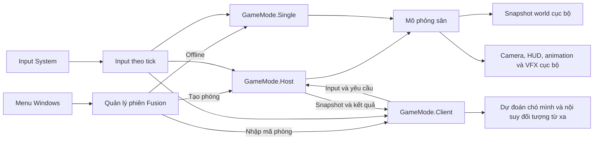

# Kiến trúc Dog Simulator cho Windows PC

*Đề xuất triển khai ngày 08/11/2026.*

Phạm vi gồm bản Windows x64, chơi offline và co-op theo mã phòng. [Kiến trúc WebGL hiện tại](NETWORK_ARCHITECTURE.md) là đường cơ sở để so sánh. [Thiết kế M3](../NEXT_STEPS_GAMEPLAY_M3.md) vẫn xác định hành vi gameplay.

## Quyết định

- **Phát hành Windows trước.** Giữ Unity 6000.3.19f1, URP, Photon Fusion 2.1.4, sân hiện tại, `DogMotor` và `CharacterController`. Xuất một bản **Windows + Shared** từ gameplay hiện có để có mốc đo hiệu năng và bản chơi thử sớm.
- **Kiến trúc PC đích là Fusion Client Host**, sau khi prototype đạt mốc ở phần nghiệm thu. Máy chủ phòng mô phỏng chó, đồ vật, NPC và xe. Khách gửi input, dự đoán di chuyển của chó mình và nội suy đối tượng từ xa. Một máy xử lý các tương tác giữa chó, NPC và vật thể theo cùng trạng thái tick. Đổi lại, tải CPU và uplink dồn vào máy chủ phòng, còn thao tác lên vật thể phụ thuộc RTT. [Fusion Client Host](https://doc.photonengine.com/fusion/v2/game-samples/fusion-starter/architecture-client-host)
- **Phiên gắn với chủ world.** Offline dùng `GameMode.Single` và cùng quy tắc gameplay. Online dùng máy người tạo phòng làm host và lưu world trên máy đó. Khi host thoát, phiên đóng và khách về menu, phù hợp với hành vi hiện tại. Nếu sau này cần world tồn tại khi chủ rời hoặc cần một bên mô phỏng đáng tin cậy cho phòng công khai, lúc đó mới thiết kế dedicated server và lưu từ xa. [Vòng đời phòng hiện tại](../../Assets/Game/Scripts/Fusion/FusionSessionService.cs) · [So sánh topology Fusion](https://doc.photonengine.com/fusion/v2/fusion-choose)
- Giữ WebGL Shared làm bản demo riêng nếu tiếp tục phân phối trên itch.io. Tách protocol và room namespace của bản Host khỏi bản Shared. Hai build có thể dùng cùng mã nguồn gameplay và catalog.

## Cấu trúc runtime

Giữ hai assembly hiện tại. `DogSimulator.Runtime` chứa input, motor, camera, visual, catalog và quy tắc gameplay dùng chung. `DogSimulator.Fusion` quản lý phiên, ánh xạ người chơi, input theo tick và đồng bộ state. Tổ chức lớp Windows chọn ảnh và lưu tệp ở ranh giới nền tảng. Giữ UI gọi `CreateAsync`, `JoinAsync` và `StartSinglePlayerAsync` để có thể chuyển phiên mà ít thay đổi menu.

| Thành phần hiện tại | Thiết kế PC đích |
| --- | --- |
| `FusionSessionService`, `FusionSessionOptions`, `FusionSessionService.Rooms` | Create dùng `Host`, Join dùng `Client` với `EnableClientSessionCreation = false`. Room browser dùng `SessionLobby.ClientServer`. Giữ mã phòng, retry khi trùng mã, timeout/cancel, trạng thái phòng đầy và thông báo lỗi. |
| `NetworkDogPlayer`, `DogInputReader`, `DogMotor` | Host spawn một avatar cho mỗi người chơi và gán `InputAuthority`. Máy sở hữu input mới gắn camera, HUD và đọc phím. Tách hàm bước motor nhận input và state theo tick khỏi camera và Animator. |
| `DogModelSelectionRegistry`, `DogModelSelectionRequest` | Host kiểm tra nickname và ID catalog trước khi hoàn tất spawn hoặc đổi model. Giữ quy tắc hiện tại cho phép trùng model. PC Host có thể dùng yêu cầu trực tiếp tới host. Prefab đăng ký Shared phục vụ bản demo. |
| `SandboxInteractionRegistry`, `NetworkCarryable` | Host xử lý yêu cầu tương tác và cập nhật vật thể. Giữ `MouthAnchor`, điểm thả, reset pose và logic hết hạn hiện có. Dùng danh sách đối tượng đăng ký theo runner cho truy vấn nóng. |
| `WorldSaveSlots`, `DogFaceStorage`, `DogFaceWebBridge` | Giữ ba slot và UI ảnh mặt. Thêm kho file cho Windows và hộp chọn PNG/JPEG chạy trong Windows Player. Giữ nhánh WebGL cho demo. |

### Phòng và quyền mô phỏng

1. Chủ chọn slot, host nạp sân, khôi phục đồ vật và spawn avatar rồi mở phòng. Giữ duyệt phòng hiện có bằng tùy chọn **Hiện trong danh sách**. Phòng chỉ mời qua mã vẫn mở để join nhưng ẩn khỏi danh sách. Mã phòng là cách tìm phiên và có thể được chia sẻ tiếp.
2. Cố định `asia` cho vòng playtest đầu. Dùng version riêng cho protocol Host và quy tắc tương thích scene/prefab, đồng thời hiển thị build ID để đối chiếu lỗi. Giữ capacity cấu hình 8 gồm host và xác nhận tải 4 người trước khi nghiệm thu 8. Test hai mạng khác nhau để kiểm tra cả đường kết nối trực tiếp lẫn relay khi NAT yêu cầu. [Matchmaking Fusion](https://doc.photonengine.com/fusion/v2/manual/connection-and-matchmaking/matchmaking) · [Kết nối và NAT](https://doc.photonengine.com/fusion/v2/manual/connection-and-matchmaking/connection-process)
3. Khi khách rời, host giải phóng ghế, thả vật ở vị trí hợp lệ và bỏ support trước khi despawn avatar. Khi host đóng phòng, ngừng nhận người mới, chụp save cuối rồi shutdown. Mất host đột ngột đưa khách về menu với lý do và dùng bản lưu hợp lệ gần nhất khi chủ mở lại. Phiên bản đầu không tự bầu host mới.

### Input, simulation và render

- `Update` gom phím, cạnh nhấn và yaw cần cho hướng đi. `OnInput` đóng gói các giá trị đã gom. `FixedUpdateNetwork` lấy input bằng `GetInput` cho host và người sở hữu input. Dùng button mask và sequence thích hợp để jump/pickup/throw không bị mất hoặc lặp khi FPS khác tick rate. Camera và UI cập nhật theo frame. Khi cửa sổ mất focus, gửi input trung tính và giữ host tiếp tục tick. [Fusion Player Input](https://doc.photonengine.com/fusion/v2/manual/data-transfer/data-transfer)
- Host là `StateAuthority` cho tất cả avatar, vì vậy code tra người thao tác bằng `StateAuthority` phải đổi sang `InputAuthority` hoặc người gửi đã xác thực. Với RPC do người chơi host gọi, xử lý trường hợp `RpcInfo.Source` mặc định là `PlayerRef.None`. Luồng offline xác định người chơi cục bộ riêng. [PlayerRef](https://doc.photonengine.com/fusion/v2/manual/playerref) · [RPC trong Host Mode](https://doc.photonengine.com/fusion/v2/manual/data-transfer/rpcs)
- Bắt đầu dự đoán di chuyển và nhảy trên địa hình tĩnh. State dùng để reconcile phải đủ pose, velocity, trạng thái grounded/cooldown và dữ liệu support cần thiết. Với chồng chó và knockback, client hiển thị từ support, offset và impulse đã được host xác nhận. Chỉ thử dự đoán va chạm động sau khi luồng này ổn định. Tách pose mô phỏng khỏi pose render để offset support không bị cộng hai lần.
- Host kiểm tra quyền, khoảng cách, cooldown và trạng thái đích trước khi commit carry/throw/reset/damage. Ghép yêu cầu với người gửi và sequence. Hai chó tranh một vật thì một yêu cầu thắng, reset chỉ do chủ thực hiện. Spawn, phát sự kiện dùng một lần và ghi file nằm ngoài phần mô phỏng có thể chạy lại. Late join dựng cảnh từ snapshot hiện tại và revision, kể cả vật đang được mang.

## Vật lý và gameplay mở rộng

| Hệ | Cách triển khai đầu tiên |
| --- | --- |
| Đồ vật, bóng và chồng chó | Host mô phỏng Rigidbody khi vật tự do. Khi ngoạm, vật chuyển sang kinematic với carrier/grip rõ ràng. Khách nội suy pose mạng và yêu cầu host thực hiện tương tác. Bắt đầu với `NetworkTransform` và tắt Forecast. Dùng collider đơn giản, collision layer cụ thể, sleep cho vật tĩnh và giới hạn vật tạm. |
| NPC | Một NPC chạy NavMesh và state machine trên host. Host xác nhận cú cắn, HP và đòn phản công. Khách nhận pose, phase và sequence để chạy animation. Tìm mục tiêu ở nhịp thấp hơn tick và dùng mốc tick cho hit/cooldown. |
| Ragdoll | Một root với collider gameplay trên host. Tay chân ragdoll cục bộ để hiển thị. Host quyết định `Downed`, grip, carrier, drop và thời điểm đứng dậy. Đồng bộ thêm khớp khi prototype chứng minh va chạm từng chi là một phần của gameplay. |
| Xe | Một xe tốc độ thấp, một ghế. Host xác nhận người lái, xử lý input lái, va chạm và điểm thoát an toàn. Khách đổi camera tại chỗ và nội suy xe. Nếu phép đo cho thấy cần prediction khi lái, thử riêng Forecast hoặc Physics Addon và đo cả chi phí resimulation ở khách. |

Đặt rõ chỗ Unity chạy physics step trong mỗi cấu hình để tránh step cùng world hai lần. Ưu tiên đo `SphereCastAll` của motor, sweep của vật ném và vòng lặp qua avatar/props. Tối ưu theo Profiler và giữ quy tắc chọn collider/support. Chỉ thêm AOI khi số liệu cho thấy replication của map lớn là nút thắt. [Fusion Networked Physics](https://doc.photonengine.com/fusion/v2/manual/physics/physics-overview) · [Physics Addon 2.1](https://doc.photonengine.com/fusion/v2/addons/physics-addon-2.1)

## Lưu world và ảnh tùy chỉnh

- **World lưu vào ba file slot** trong `Application.persistentDataPath` với `schemaVersion`, `mapId`, ID prop ổn định và pose. Snapshot đầu tiên lưu prop cố định như hiện tại. Trạng thái tạm như carrier, NPC đang tấn công và kết nối người chơi khởi tạo lại khi mở world. Đọc save `PlayerPrefs` phiên bản cũ một lần trên cùng máy, ánh xạ index theo danh sách prop của map cũ, kiểm tra pose rồi chỉ đánh dấu đã nhập sau khi ghi và đọc lại thành công. Giữ bản cũ để khôi phục. Save trong trình duyệt cần luồng export/import riêng nếu có nhu cầu chuyển sang Windows. [WorldSaveSlots hiện tại](../../Assets/Game/Scripts/Fusion/WorldSaveSlots.cs) · [Unity persistentDataPath](https://docs.unity.com/en-us/engine/6000.3/script-reference/unityengine/application/persistentdatapath)
- **Ghi file qua một hàng đợi tuần tự.** Lấy bản sao dữ liệu thuần trên main thread, gộp các lần cập nhật cùng slot, ghi và flush file tạm cùng thư mục rồi thay file chính và giữ backup. Lưu theo thay đổi với debounce và chờ lần ghi cuối khi Leave/Quit trong thời gian hữu hạn. Nếu ghi thất bại, báo lỗi slot và giữ bản hợp lệ trước đó. Nickname và cài đặt nhỏ có thể giữ trong `PlayerPrefs`.
- **Picker Windows** trả byte cho editor ảnh hiện có, tái dùng giới hạn kích thước và JPEG 512×512, tối đa 128 KiB. Trong Host Mode, khách gửi JPEG tới host qua data streaming. Host xác thực avatar, độ dài, ảnh và hash, áp dụng giới hạn tần suất rồi công bố manifest gồm model/layout/hash/revision. Khách nhận hoặc yêu cầu lại theo hash, dùng cache giới hạn theo phiên và hiển thị mặt mặc định khi ảnh chưa sẵn sàng. Bỏ payload cũ khi revision đã đổi. Kiểm thử host, khách, late join, đổi model và reset ảnh. [Giới hạn ảnh hiện tại](../../Assets/Game/Scripts/CustomDogFace/CustomDogFaceConstants.cs) · [Fusion Data Streaming](https://doc.photonengine.com/fusion/v2/manual/data-transfer/data-streaming)

## Build Windows và ngân sách thử nghiệm

- Tạo Build Profile `Windows x64 Development` có Profiler và log chẩn đoán, cùng `Windows x64 Release` tắt Development và giữ symbols riêng. Bắt đầu với Direct3D 11 và URP asset PC đang có. Đo Mono làm baseline, chạy smoke và đo lại với IL2CPP trước khi chọn backend cho bản phát hành. Đóng gói đủ thư mục Player, kèm build ID và kiểm thử trên máy Windows không cài Unity. [Build Profiles](https://docs.unity.com/en-us/engine/6000.3/manual/building-and-publishing/build-settings/build-profiles) · [Windows build settings](https://docs.unity.com/en-us/engine/6000.3/manual/platform-specific/windows/standalone-binaries)
- Dùng scene hiện tại để làm bản baseline. Tách `Bootstrap` cho menu, session và thiết lập, `Yard` cho sân khi chuyển vòng đời phiên sang Host. Host điều phối scene mạng và chỉ mở phòng sau khi world sẵn sàng. Giai đoạn đầu dùng nội dung đóng gói cùng Player. Dựa vào thời gian tải và bộ nhớ đo được để quyết định có tách bundle hay không.
- Tái dùng URP asset PC để tạo Low/Medium/High theo bóng, render scale, ánh sáng bổ sung và LOD. Mọi preset dùng cùng collider và quy tắc mạng. Chạy test ở 1080p Low/Medium trước. Đo render riêng với simulation và hạ chất lượng hình ảnh nếu GPU là nút thắt.

| Chỉ số | Mốc thử nghiệm đề xuất |
| --- | --- |
| Quy mô | Hai máy thật cho vòng đầu, sau đó 4 và 8 người tính cả host. Sân thử có đồ ngoạm/ném và chồng chó. Thêm NPC, ragdoll và xe lần lượt để đo phần tải tăng thêm. |
| Render | 1080p Low trên PC mục tiêu. Mục tiêu p95 frame time ≤ 16,7 ms cho host và khách trong kịch bản 4 người. Ghi p99 và các spike khi ném, late join, đổi ảnh và ghi save. |
| Simulation | Bắt đầu thử Host ở tick 60 Hz và gửi snapshot 30 Hz. Mục tiêu p95 chi phí một bước host gồm gameplay và physics ≤ 6 ms trong kịch bản 4 người. Ghi thời gian resimulation của khách riêng. [Tick và send rate của Fusion](https://doc.photonengine.com/fusion/v2/manual/network-project-config) |
| Mạng và cảm giác chơi | Đo LAN và Internet. Chạy thêm kịch bản RTT khoảng 80 ms, jitter 15 ms và mất gói 1%. Mục tiêu p95 phản hồi đã xác nhận của pickup/throw ≤ 200 ms trong kịch bản mô phỏng. Ghi correction của chó, traffic, loại kết nối và thời gian vào phòng. |
| Tính đúng | Vật đang được mang có đúng một carrier. Khách rời thì ghế và support được giải phóng. Late join thấy đúng pose, HP, carrier và ảnh mặt. Sau khi dừng tiến trình giữa lần ghi, kiểm tra có thể mở bản lưu hợp lệ gần nhất. |

Các số trên là mục tiêu đo, cần chốt cấu hình PC tối thiểu trước khi nghiệm thu. Mỗi lượt ghi build, phần cứng, driver, preset, RTT, số người và workload. So sánh Windows Shared với Windows Host trên cùng máy, cùng scene và cùng kịch bản. Chạy ít nhất ba lượt 10 phút sau warm-up cho mỗi cấu hình cần so sánh. Lấy một lượt Development để chẩn đoán và dùng Release tương ứng để chốt frame time.

## Thứ tự triển khai và điều kiện chuyển

1. **PC-0 — Windows Shared baseline.** Chạy offline và hai client Windows qua hai mạng. Kiểm tra menu, mã phòng, carry/throw/drop, chồng chó, world slot và thoát phòng. Đo CPU, GPU, tick, mạng, bộ nhớ và GC. Thêm picker Windows nếu phát hành bản thử có tùy chỉnh mặt.
2. **PC-1 — Prototype Host.** Trên sân hiện tại làm create/join, một avatar mỗi người, input theo tick, di chuyển/nhảy và một vật carry/throw. Thử client prediction với độ trễ, tranh nhặt cùng vật, late join, mất khách và mất host. Chỉ chuyển mặc định sang Host khi gameplay đạt tiêu chí tính đúng, không có correction gây mất kiểm soát và đạt ngân sách 4 người trên máy chủ phòng mục tiêu. Nếu Host hụt mốc, tiếp tục playtest Windows Shared và xử lý phần hụt có số đo.
3. **PC-2 — Tương đương tính năng.** Chuyển phần còn lại của sandbox, settings, picker, stream mặt, migration ba world slot và luồng quit. Thử lại ở 8 người trước khi công bố capacity. Giữ Windows Shared làm mốc so sánh trong quá trình chuyển.
4. **PC-3 — Mở rộng vật lý.** Thêm một NPC phản công, một ragdoll mang được và một xe nhỏ theo các đợt riêng. Sau mỗi đợt đo lại tải host, độ trễ ở khách và chất lượng chơi. Tăng số lượng khi workload hiện tại còn ngân sách.
